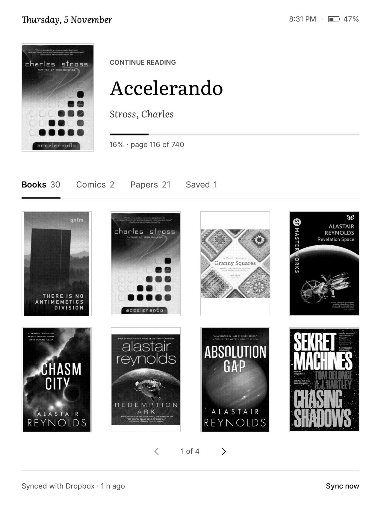
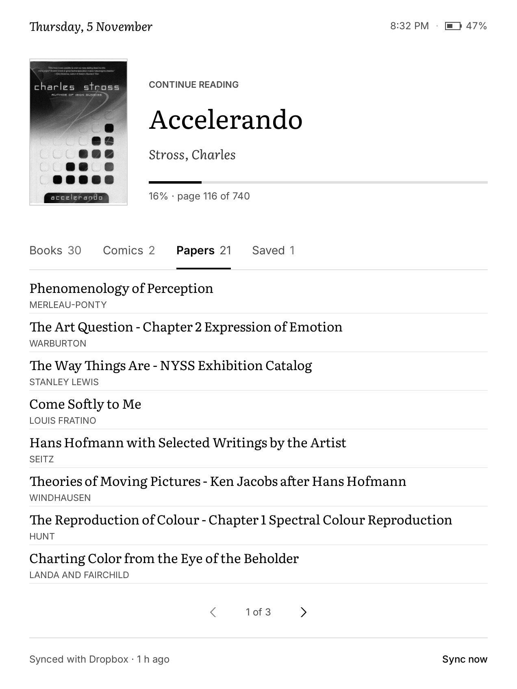
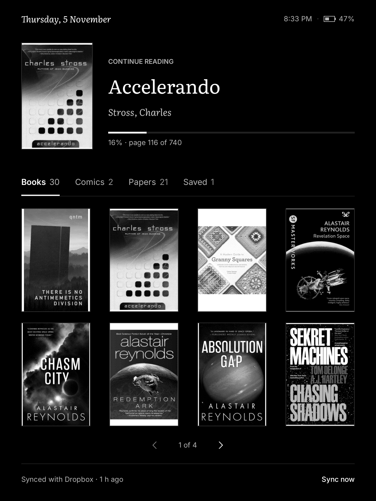
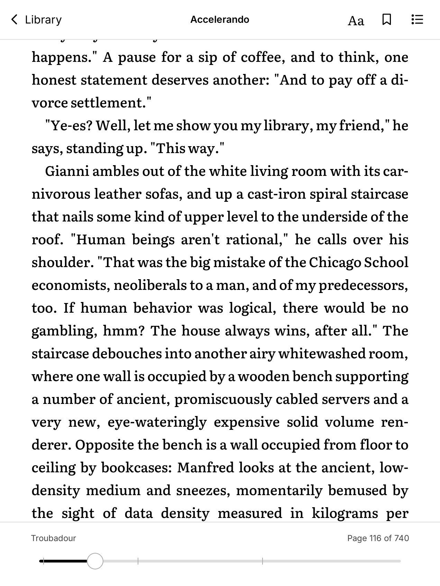
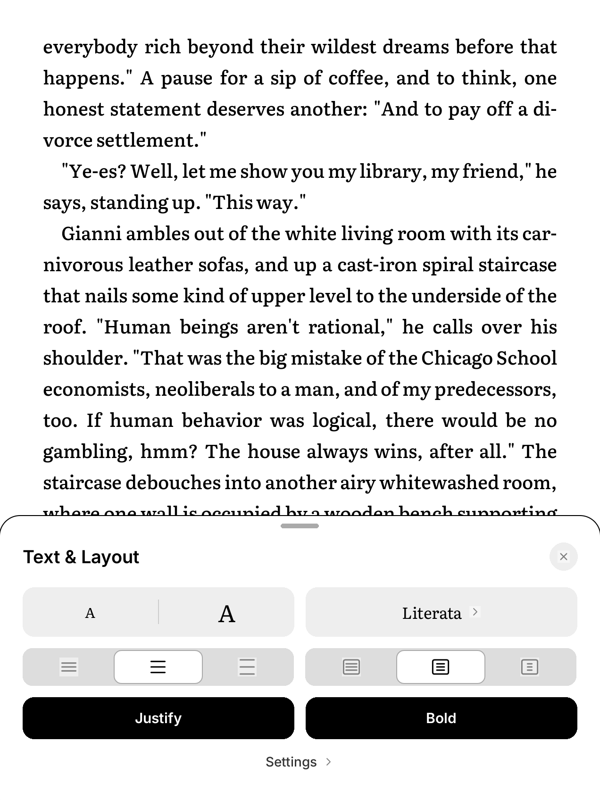
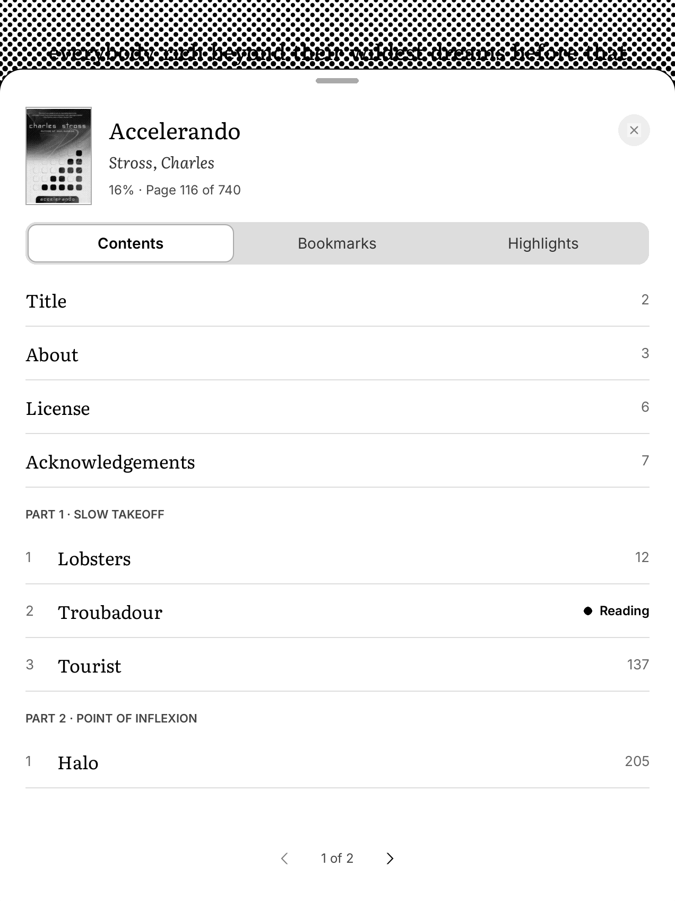
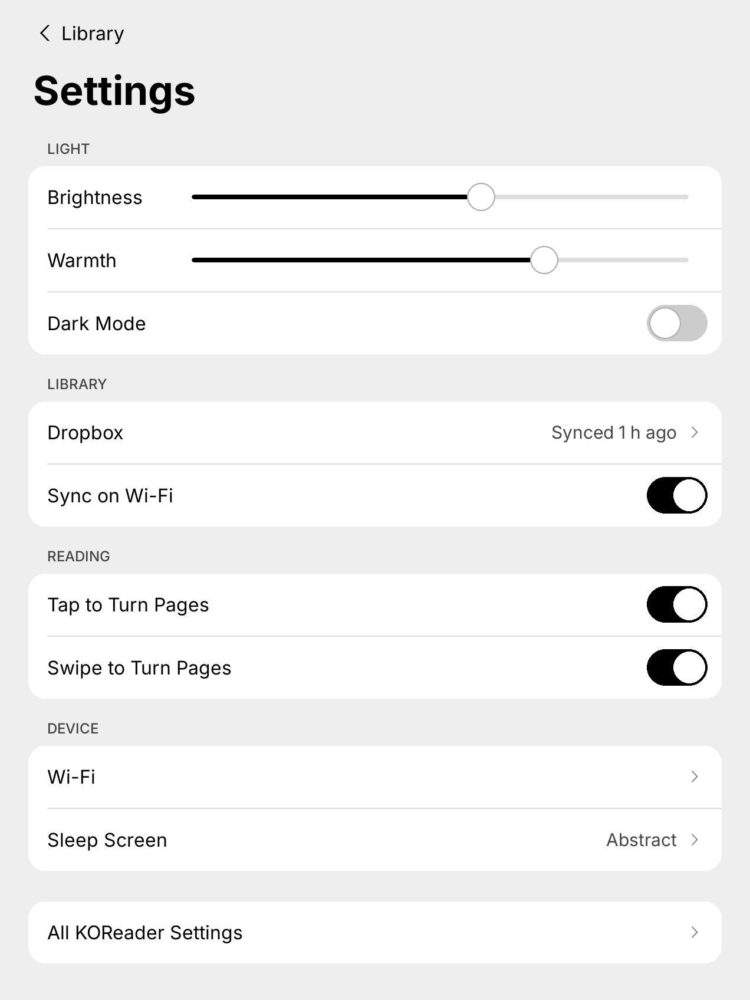

# kindling

Some mods to burn the Amazon UI off my jailbroken Kindle Paperwhite and put a KOReader setup in its place. Has a real home screen, calmer menus, books delivered from a Dropbox sync, and neat screensavers.

Built on KOReader v2026.07.1, on a Kindle Paperwhite (6th gen).

<table>
  <tr>
    <td></td>
    <td></td>
    <td></td>
  </tr>
  <tr>
    <td></td>
    <td></td>
    <td></td>
  </tr>
</table>

<p align="center"></p>

## What's here

| Component | Path | What it does |
| --- | --- | --- |
| `homescreen` | `koreader/plugins/homescreen.koplugin` | Home screen for `/mnt/us/library`. Shows what you're reading first, then each section as covers or a title list, and marks new books. |
| `kindleui` | `koreader/plugins/kindleui.koplugin`, `koreader/icons/` | Simpler settings, reading controls, and contents and text sheets, styled to match the home screen. |
| `menus` | `koreader/patches/2-home-ui.lua` | User patch that restyles KOReader's menus and popups with Inter, thinner frames, rounder corners, and lighter dividers. |
| `dropboxsync` | `koreader/plugins/dropboxsync.koplugin`, `rclone/sync-books.sh` | Pulls new books from `Dropbox:/Library` with rclone and shows how the last sync went. |
| `styletweaks` | `koreader/styletweaks/` | Custom CSS style tweaks. `Calm_chapter_headings.css` tones down chapter headings. |
| `gestures` | `koreader/settings/gestures.lua` | My gesture mappings. |
| `screensavers` | `screensavers/` | Generative screensavers: halftones, dithering, and patterns. |

The plugins work on their own and pick up each other's features when they're installed together. Without `kindleui`, the home screen's settings button does nothing; without `dropboxsync`, the "Sync now" button does nothing.

## Install

### From a release

Grab a zip from [Releases](https://github.com/michaeleggar/kindling/releases), plug the Kindle in over USB, and unzip it onto the root of the Kindle drive. `kindling-all.zip` has everything; the others hold one component each. Zips that need fonts already include them. Restart KOReader.

### From the repo, over SSH

The scripts expect `ssh kindle` to reach the device (KOReader's SSH plugin listens on port 2222).

```sh
./install.sh                         # push every component
./install.sh homescreen kindleui     # or just the ones you want
./install.sh -H otherkindle menus    # use a different SSH host
./pull.sh                            # copy on-device edits back into the repo, then review with git diff
```

`install.sh` runs `fetch-fonts.sh` when a component needs fonts. That downloads Inter 4.1 and Literata 3.103 from their GitHub releases, checks them against `fonts.sha256`, and keeps them out of git. Restart KOReader after installing.

Installing `gestures` replaces your own gesture settings, so leave it out unless you want mine.

### Dropbox sync setup

Download the `linux-arm-v7` build of rclone from [rclone.org](https://rclone.org/downloads/) and put the binary at `/mnt/us/rclone/rclone`. Then run `rclone config` on a computer to authorize Dropbox, and copy the remote it creates (named `dropbox`) to `/mnt/us/rclone/rclone.conf`. `rclone/rclone.conf.example` shows the format. Don't commit the real file, because it holds your Dropbox token.

## Paths

The library location (`/mnt/us/library`) and the Dropbox folder (`Dropbox:/Library`) are hard-coded near the top of `homescreen.koplugin/main.lua`, `dropboxsync.koplugin/main.lua`, and `sync-books.sh`. Change them there if your setup differs.

## Releases

`./make-release.sh` builds the zips into `dist/`. Then:

```sh
gh release create vX.Y.Z dist/*.zip
```

## License

AGPL-3.0, the same as KOReader. See [LICENSE](LICENSE). The bundled fonts are under the SIL Open Font License 1.1, and their license files ship next to them.
